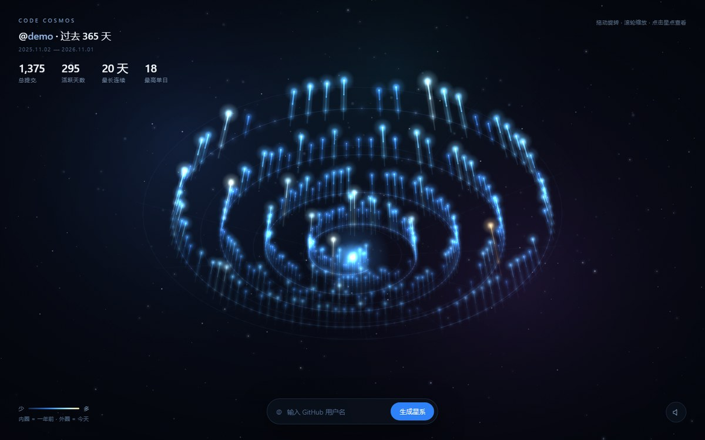

# Code Cosmos · 代码星云

> 输入一个 GitHub 用户名，把他过去一年的每一次提交，变成一片可以走进去的星云。

**在线体验** → https://YOUR_NAME.github.io/code-cosmos/



---

## 这是什么

GitHub 的贡献图是 53 × 7 个绿色小方块，它精确，但抽象。你只能「读」它，没法「走进去」。

这个项目把 365 天摊开成一条螺旋：**一天一颗星，绕四圈就是一年**。

- 柱子的高度 = 当天的提交数
- 颜色从深蓝走到暖金，越亮代表那天越拼
- 越靠外圈，越接近现在
- 拖动可以旋转，滚轮可以缩放，点一颗星能看到那天你交了几次代码

那些稀疏的、暗淡的、断掉的地方，恰好就是你没有写代码的日子。它比一张绿色方块图更诚实。

## 功能

- 输入任意 GitHub 用户名，实时生成属于他的星系
- 标题下方一行小字标出数据覆盖的时间范围
- 365 天 = 365 根光柱，螺旋排布，入场带生长动画
- 拖拽旋转 / 滚轮缩放 / 点击查看单日详情
- 视角转偏后右下角浮出「回正视角」，一键平滑回到默认机位
- 鼠标移动时镜头轻微视差，幅度很小，不影响正常查看
- 光柱在地面上有倒影，配合同心圆网格撑起立体感
- 顶部统计：总提交、活跃天数、最长连续、最高单日
- 宇宙背景音（右下角按钮开启），与画面呼吸联动
- 数据三层兜底，断网也能演示

## 技术

纯前端单文件，**零依赖、零构建**，双击 `index.html` 就能跑。

| 部分 | 做法 |
| --- | --- |
| 渲染 | Canvas 2D + 手写透视投影 + 画家算法深度排序 |
| 辉光 | 整帧降采样到 1/6 再放大叠加，得到柔和的 bloom，不需要 WebGL |
| 光晕 | 预渲染 10 档径向渐变贴图，用 `globalCompositeOperation = 'lighter'` 叠加 |
| 景深 | 按相机距离衰减亮度并偏冷，近处亮、远处暗 |
| 立体 | 透视投影 + 地面网格 + 光柱倒影 + 指针微视差 |
| 声音 | Web Audio 实时合成：振荡器铺底 + 五声音阶随机铃声 + 反馈延迟 |
| 布局 | 极坐标阿基米德螺旋，365 天均匀分布在 4 圈上 |
| 性能 | 365 个对象逐帧投影 + 排序，桌面端稳定 60fps |
| 数据 | GitHub 贡献图镜像 → 公开事件接口 → 内置示例数据 |

**为什么不用 Three.js？** 一个只有 365 个点的场景，自己写投影矩阵比引入一个 600KB 的库更划算 —— 加载快、零依赖，而且每个像素是怎么来的我都能讲清楚。

### 关于那段背景音

没有加载任何音频文件，也没有版权问题。它是由几个振荡器现场合成的：

- 55Hz 的正弦波铺底，给一个「宇宙很大」的低频
- Am7 和弦的五个音，各自轻微失谐，制造缓慢的拍频
- 一个 0.045Hz 的 LFO 扫过低通滤波器，声音像在缓缓呼吸
- 随机间隔 2.6～7.8 秒落一个五声音阶的铃声，送进反馈延迟里形成空间感

每次铃声响起，星系核心的光晕会同步放大一次 —— 声音和画面是同一条时间线。

### 数据来源

1. `github-contributions-api.jogruber.de` —— 贡献图镜像，拿完整的 365 天
2. `api.github.com/users/{name}/events/public` —— 镜像不可用时的降级方案，只覆盖最近约 90 天
3. 内置示例数据 —— 前两个都失败时使用，保证任何网络环境下都能演示

## 本地运行

```bash
git clone https://github.com/YOUR_NAME/code-cosmos.git
cd code-cosmos
```

直接双击 `index.html` 即可。或者起一个静态服务：

```bash
python -m http.server 8000
# 打开 http://localhost:8000
```

## 迭代记录

| 版本 | 内容 |
| --- | --- |
| v0.1 | 把 365 天数据排成螺旋光柱（骨架） |
| v0.2 | 拖拽旋转、滚轮缩放、点击查看单日 |
| v0.3 | 接入 GitHub 用户名，三层数据兜底 |
| v1.0 | 光晕与景深、统计面板、移动端适配 |
| v1.1 | 辉光后期、悬浮尘埃、景深雾化、星点呼吸、宇宙背景音 |
| v1.2 | 立体感加强：更斜的视角、地面网格、光柱倒影、鼠标微视差 |
| v1.3 | 时间范围标注、回正视角按钮、拖拽灵敏度与视差幅度调低 |

## License

MIT
